# Studio CRM

**The free studio management app for tattoo and piercing studios.** Clients, consent forms signed on a tablet, appointments and deposits, stock and lots, compliance records, and 31 studio tools, in 8 languages. It runs on one computer in your studio, and your data never leaves it.

[**Download**](#download) · [User guide](docs/USER-GUIDE.md) · [Try the online demo](https://poliinternational.com/tools/studio-crm/) · [Releases](https://github.com/Poli-International/studio-crm/releases)

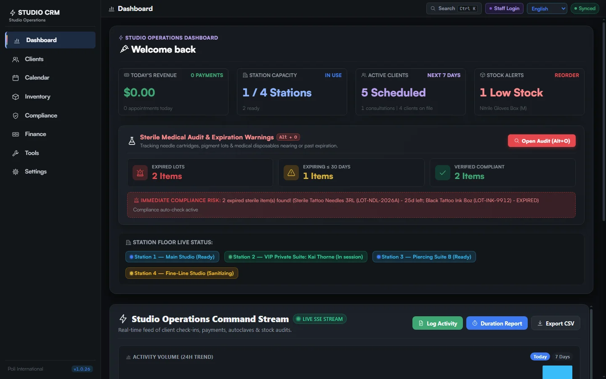

- **Free, with nothing to sign up for.** No account, no subscription, no limits on clients or staff.
- **Your data stays in your studio.** Everything is in one file on your computer. Nothing is sent to Poli International or anyone else.
- **Made for the front desk.** Staff use it from any browser in the studio: the desk PC, a laptop, a tablet on a stand.
- **Updates in one click,** and your data is backed up first.

## Download

Download the ZIP for your computer, unzip it, and double-click the starter. Your browser opens on the CRM. Node.js is inside: there is nothing else to install.

| Computer | Download | Starter |
|---|---|---|
| Windows | [studio-crm-windows-x64.zip](https://github.com/Poli-International/studio-crm/releases/latest/download/studio-crm-windows-x64.zip) | `Start Studio CRM.bat` |
| Mac, Apple chip (M1 and newer) | [studio-crm-macos-arm64.zip](https://github.com/Poli-International/studio-crm/releases/latest/download/studio-crm-macos-arm64.zip) | `Start Studio CRM.command` |
| Mac, Intel | [studio-crm-macos-x64.zip](https://github.com/Poli-International/studio-crm/releases/latest/download/studio-crm-macos-x64.zip) | `Start Studio CRM.command` |
| Linux | [studio-crm-linux-x64.zip](https://github.com/Poli-International/studio-crm/releases/latest/download/studio-crm-linux-x64.zip) | `./start-studio-crm.sh` |

Keep the window that opens while you use the CRM; closing it stops the CRM. On a Mac, the first time, right-click the starter and choose **Open**. A new install opens with a demo studio so you can try every screen; **Start with an empty studio** on the Dashboard clears it.

## What it does

### Clients and their safety profile

Every client with their contact details, allergies and medical history, signed forms, appointments, staff notes, work photos and total spent. Allergies show in red on the client list, so the desk sees them before the client sits down.

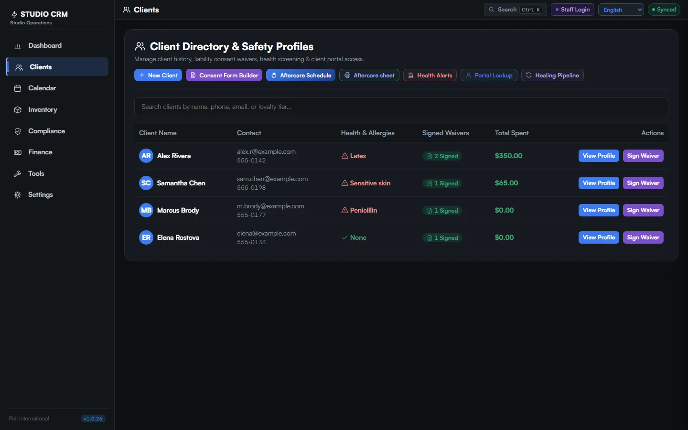

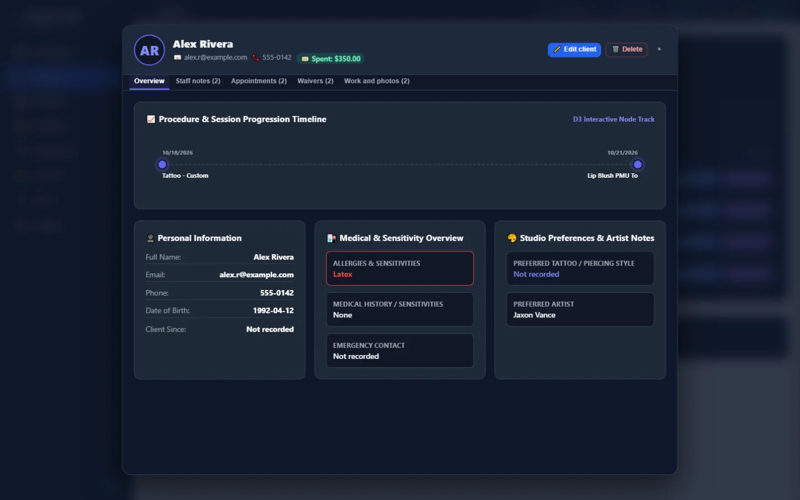

### Consent forms, signed on a tablet

Build your own consent forms, or start from ready-made tattoo, piercing and medical history templates. The desk sends a form to a tablet; the client fills it in, signs with a finger and taps Complete. The form lands on the client's record with every answer, and prints as a laid-out PDF with the signature.

- A **kiosk tablet** can only receive and return forms: it never opens the CRM or sees other clients. Several tablets each get their own forms.
- **Required questions** must be answered before the client can go on.
- What the client declares (allergies, conditions, medication) is added to their **medical overview**.
- **Clients under 18** are flagged from their date of birth, and their forms need a parent or guardian signature. The desk records an **ID check** (the type of ID and its last 4 characters only), and each signed form keeps the age and the ID check.
- Your studio's name, address and licence number on every form, set once in **Settings**, **Studio details**.
- A **Scanner** field: a page from a scanner plugged into the CRM computer (WIA on Windows, which most TWAIN scanners support; SANE on Linux), straight into the form, from the desk or a tablet.
- **Aftercare sheets** (tattoo, piercing, fine line, PMU, or your own) in your own words and in all eight languages, printed from the client's profile with their name, and recorded: each appointment shows whether aftercare was given.
- Forms in the client's language, with the PDF in that language too.

| | |
|---|---|
| 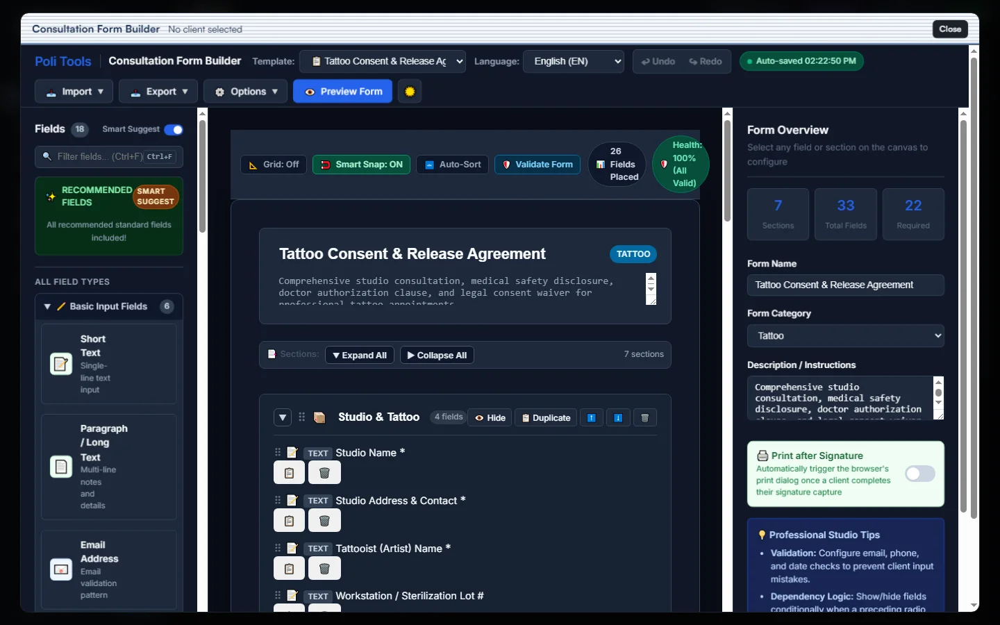 | 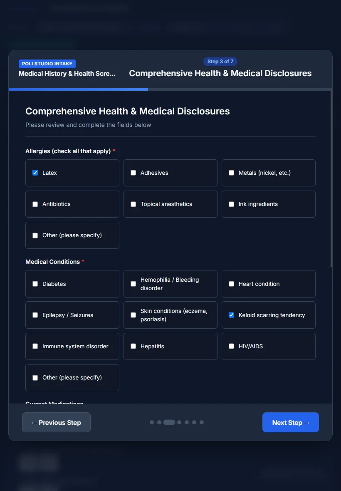 |

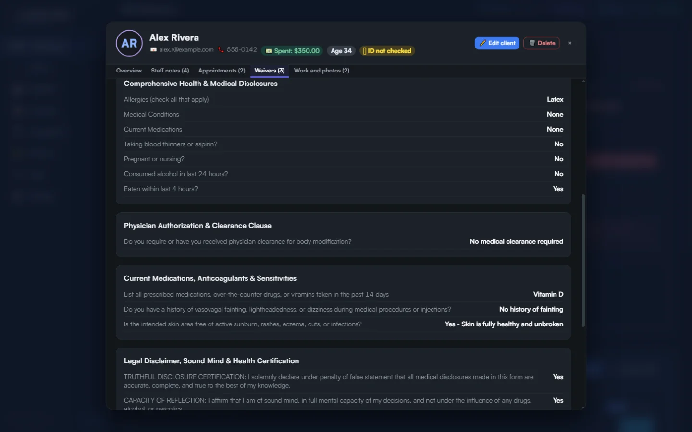

### Appointments, deposits and payments

Book sessions with a price and a deposit, see what is still to pay, plan the staff rota, and record payments. Your own stations (tattoo room, piercing room, branding...), each with a usual artist who is placed there when booked. Marking a session as completed offers to record its payment, so each client's total stays right. An auto scheduler finds an artist's free slots for multi-session work.

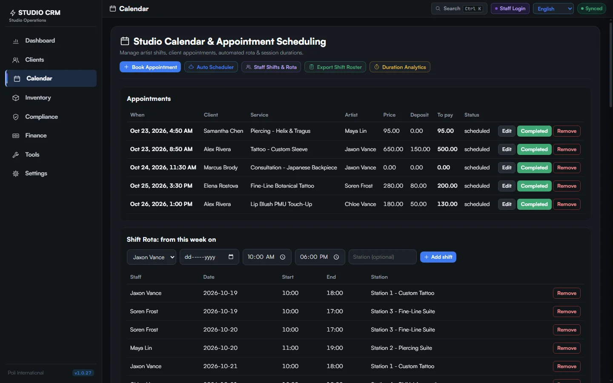

### Stock, lots and suppliers

Quantities, lot numbers, expiry dates and suppliers, with low-stock and expiry warnings on the dashboard. A camera QR and barcode scanner, printable stock labels, and purchase orders as PDF, ready to send.

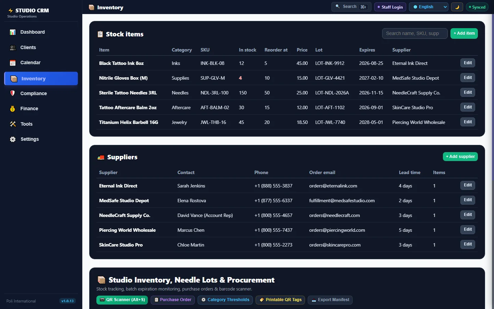

### Money, worked out from your own records

Payments this month, deposits held, what is still to collect, and sessions completed, all calculated from what the studio entered. Tip splits, artist splits, VAT and tax rates, and exports to CSV and PDF.

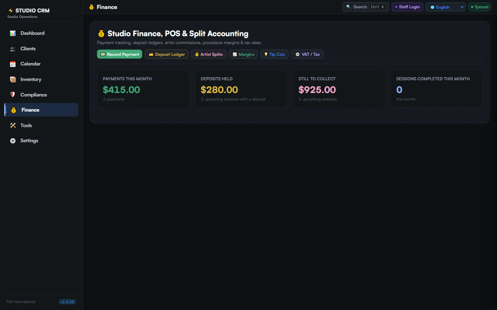

### Compliance records

Autoclave cycle log, station sanitisation checklist, signed forms and a sterile lot audit, with expired and soon-to-expire lots flagged on the dashboard.

### 31 studio tools built in

The [Poli International tools](https://poliinternational.com/tools/), inside the CRM: consent form builder, aftercare schedules, tattoo price estimator, gauge converter, stencil calculator, autoclave calculator, medication interaction checker, ink mixer, booth rent vs commission, and more.

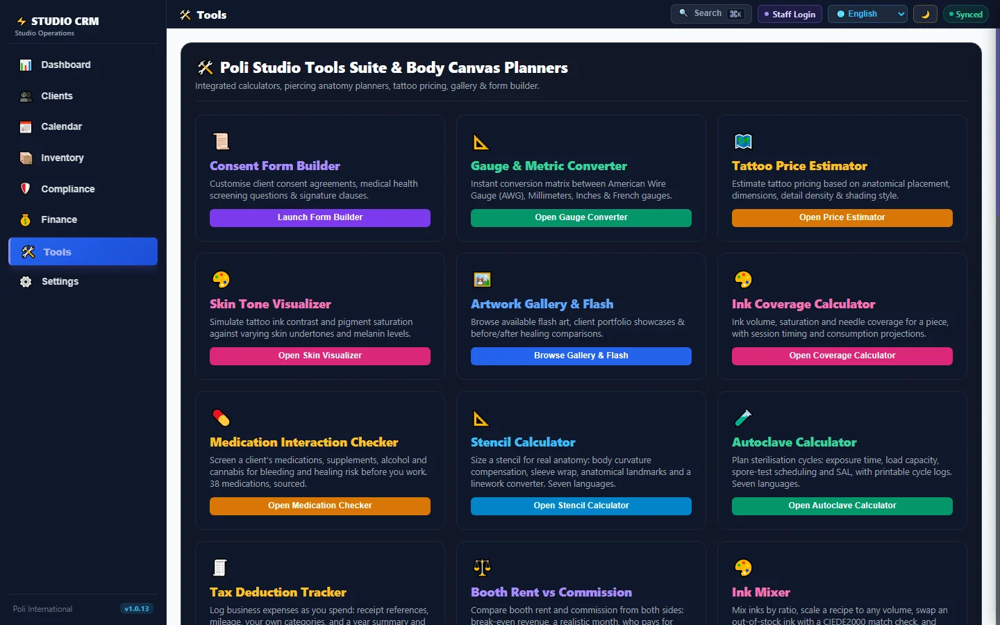

### 8 languages

English, French, Italian, German, Spanish, Dutch, Portuguese and Thai: the screens, the user guide, the consent forms and the PDFs. Each person picks their own language.

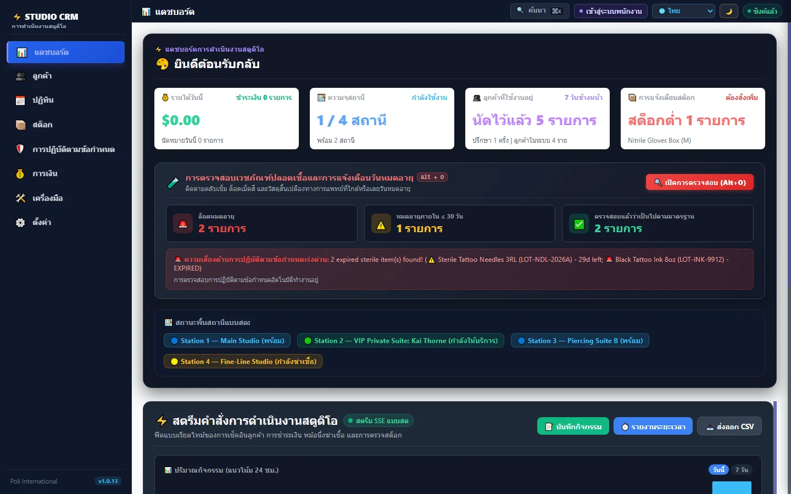

### Security for a shared studio

- A **studio password** keeps other people on your network out (the first start asks for it; you can set it later).
- **Staff logins** with levels: Front desk, Staff, Administrator, checked on the server.
- A device that is not used locks itself after 5 to 30 minutes.
- **Kiosk tablets** sign in with their own password and can do nothing but forms.

### Updates in one click

When a new version is out, the menu says **update available**. **Settings**, **Updates**, **Update now**: the CRM backs up your database, tries the new version on a copy of your data, and only then installs it and restarts. Your data is never moved; if anything goes wrong, nothing changes.

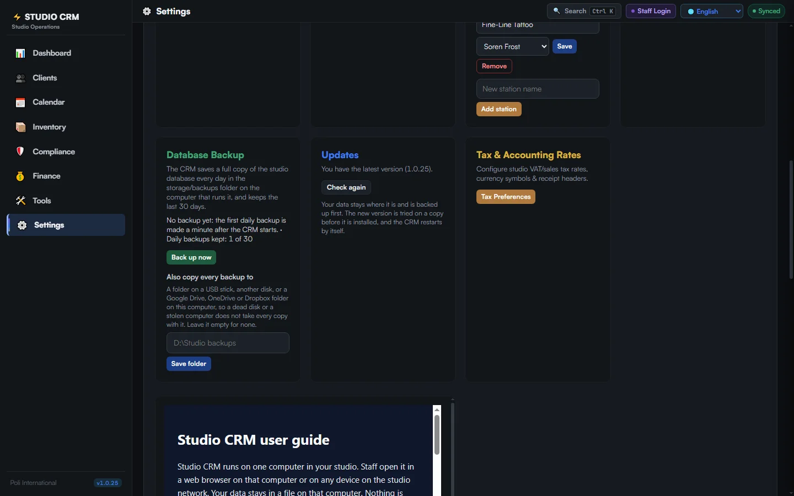

The CRM prepares messages (aftercare emails, reminders, supplier orders) and opens them in your own email, WhatsApp or LINE. It does not send anything by itself.

## Other ways to install

**From the source.** Requires [Node.js](https://nodejs.org/) 22 or newer (no compiler or build tools needed).

```bash
npm install
npm start
```

**With Docker.**

```bash
docker compose up -d
```

Then open `http://localhost:3000`. The CRM is its own web server: do not put the files behind Apache, nginx or PHP, the pages would load but nothing would save. Settings go in a `.env` file (copy `.env.example`): `PORT`, `STUDIO_MANAGER_EMAIL`, `SQLITE_DB_PATH`. These copies are updated the way they were installed; one-click updates are for the downloads above. Versions before 1.0.12 update once by hand: download the new ZIP, unzip it to a new folder, and copy your `data` folder from the old one into it.

## Other devices in the studio

- Computers open `http://THE-COMPUTER:3000`. **Settings**, **Kiosk Tablets** shows the computer's address.
- Tablets and phones that need the camera (the scanner) open `https://THE-COMPUTER:3443`. The certificate is made by the CRM itself, so the browser warns once: choose **Advanced**, then **Continue**. `HTTPS_PORT=0` turns https off.
- Give the CRM computer a fixed address in your router ("DHCP reservation" or "static IP"), or the tablets lose it when the address changes.
- Forgotten the studio password: create an empty file `reset-password.txt` in the `data` folder and restart; it removes the studio password and the staff logins.

## Backups

All data is in `data/studio_crm.sqlite`. The CRM saves a full copy in `storage/backups/` every day and keeps the last 30 days; **Back up now** in Settings saves one at any time, and every update makes one first. In **Settings**, **Database Backup**, **Also copy every backup to** a second folder (a USB stick, another disk, or a Google Drive, OneDrive or Dropbox folder) so a dead disk or a stolen computer does not take every copy with it.

## User guide

In the app under **Settings**, or in [`docs/USER-GUIDE.md`](docs/USER-GUIDE.md) and [`docs/user-guide/`](docs/user-guide/) (FR, IT, DE, ES, NL, PT, TH).

## Ideas and problems

Studio CRM is shaped by the studios that use it. [Open an issue](https://github.com/Poli-International/studio-crm/issues) or [contact us](https://poliinternational.com/contact-us/). Not all translations have been checked by native speakers yet: a sentence that reads wrong in your language is worth telling us about too.

## Development

```bash
npm test                      # unit tests
npm run test:click            # real clicks in Chrome or Edge: the daily jobs, then every button
npm run guide                 # rebuild public/guide/<lang>.html from docs/
node scripts/screenshots.mjs  # retake the screenshots in docs/screenshots
```

The click test (`tests/click/`) starts the app on a throwaway database, opens a real browser and uses the mouse. `flows.mjs` does the jobs a studio does every day (clients, staff, bookings, payments, exports, clock in, CSV import, forms on a kiosk tablet with every kind of answer), plus the awkward cases: two quick taps on Save, every screen at phone width, a restart with a form waiting on a tablet. `crawl.mjs` clicks every button it can reach and fails on one that does nothing, throws an error or is covered by something else; the release workflow does the same inside each tool. Before a release is published, each download is unpacked and started on Windows, macOS (Apple chip and Intel) and Linux with no Node.js on the PATH, and updates itself from Settings. A dead button or a failed update blocks the release.

Interface text is translated by `public/js/i18n-phrases.js` from `public/i18n/<lang>.json`, keyed on the exact English text.

## License

MIT, see [LICENSE](LICENSE).
